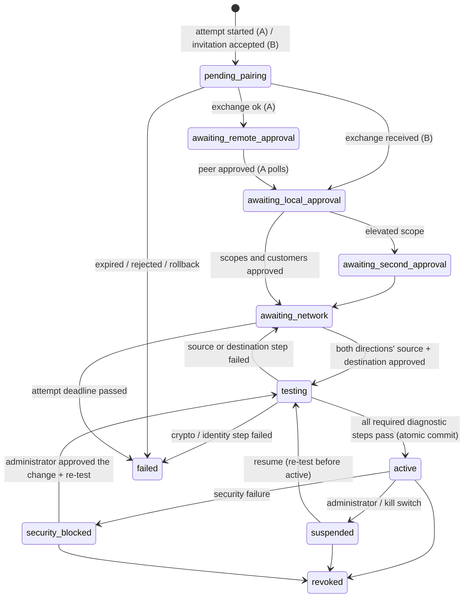
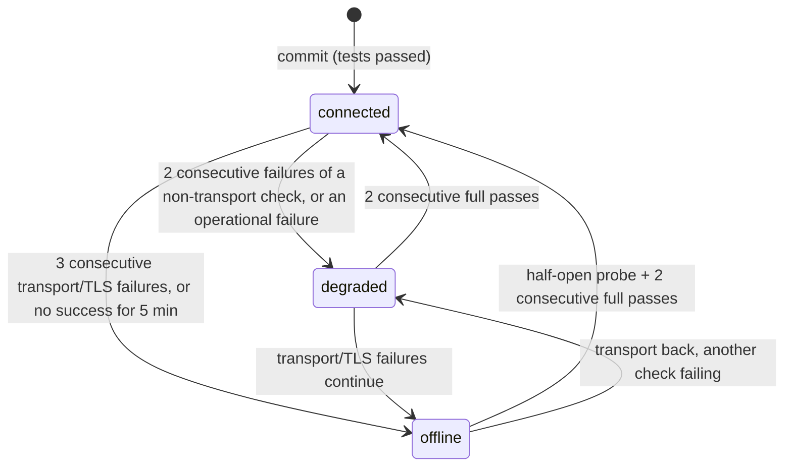

# Connection lifecycle, health and diagnostics

Recommended host behaviour. Only `qc-diagnostics/1` (`POST qc_probe`) is on the wire
([QUICK_CONNECT_SPECIFICATION.md](QUICK_CONNECT_SPECIFICATION.md) §8); lifecycle states, health, diagnostic steps
and alerts are local to each installation and never sent to the peer.

## 1. Lifecycle

Rules:

- `active` is entered **only** from `testing`, by one commit that runs after a passing connection test. Showing
  "Connected" as soon as both administrators approve, before any token or connectivity check, hides broken
  connections until data goes missing.
- Every transition into `active`, and every resume, is refused while the kill switch is engaged.
- v1 code-flow connections follow the same machine.

Reference implementation (Python): `lifecycle.transition` enforces this table (and refuses `active` without a
passing test in the same commit, or while the kill switch is engaged); `lifecycle.Health` implements the
hysteresis of §2. The in-memory reference peer uses a simplified subset of the states.

## 2. Health while active

Security failures skip hysteresis and move the connection to `security_blocked` at once
([AUTO_RECONNECT.md §1](AUTO_RECONNECT.md#1-security-failures-never-reconnect)).

## 3. Displayed status

One function maps lifecycle + health to what people see, used by every page, API answer and alert:

| Displayed | Condition |
|---|---|
| Pending Setup | `pending_pairing` |
| Awaiting Approval | `awaiting_remote_approval`, `awaiting_local_approval`, `awaiting_second_approval` |
| Awaiting Network Authorization | `awaiting_network` |
| Testing | `testing` |
| Connected | `active` and health `connected` |
| Degraded | `active` and health `degraded` |
| Offline | `active` and health `offline` |
| Security Blocked | `security_blocked` |
| Suspended | `suspended` |
| Revoked / Setup failed | `revoked` / `failed` |

## 4. Health check

Every 60 s (±10 % jitter) per active connection, with a full diagnostic every 15 min, on demand and on recovery:

1. DNS resolution + approved-destination pin.
2. TCP + TLS + certificate / SPKI.
3. Token (reuse a cached token valid for more than 30 s).
4. `POST test`, or `POST qc_probe` when the peer advertises `qc-diagnostics/1`.

Only availability failures (DNS timeout, TCP refused/reset, TLS timeout, HTTP 5xx, 429) count towards
degraded/offline.

## 5. Diagnostic steps

Each step returns `{id, name, status: pass|fail|skipped|not_tested, code, explanation, next_action, at, duration_ms,
data}`. `data` is sanitised (addresses, certificate subject/issuer/SANs/expiry/SPKI hash, HTTP status, protocol
version, counts) and never holds tokens, assertions, proofs, codes, signatures or keys. A step whose prerequisite
failed is `skipped`.

| # | Step | Pass when | Typical codes |
|---|---|---|---|
| 1 | DNS | host resolves | `dns_nxdomain`, `dns_timeout` |
| 2 | Approved destination | every resolved address is in the pin | `destination_changed` |
| 3 | TCP | connects within 5 s | `tcp_refused`, `tcp_timeout` |
| 4 | TLS handshake | TLS ≥ 1.2 | `tls_version`, `tls_handshake` |
| 5 | Certificate | valid for the name/IP; SPKI pin if set; expiry > 7 days (warn < 21) | `certificate_invalid`, `certificate_name_mismatch`, `spki_mismatch`, `certificate_expiring` |
| 6 | Discovery / protocol | valid document, common version, required extensions | `unsupported_version`, `invalid_request` |
| 7 | Identity | installation id equals the stored one | `identity_changed` |
| 8 | Source address | the peer accepts our source (`qc_probe` `checks.source`); the peer's last observed source is in our rules | `source_not_authorised` |
| 9 | Key / token | token obtained with the active key; JWKS endorsement valid | `invalid_client`, `replayed`, `key_revoked` |
| 10 | Permissions | granted scopes ⊇ committed scopes | `scope_withdrawn` |
| 11 | Tenant mapping | capabilities match our grants | `tenant_mismatch` |
| 12 | Authorised operation | one harmless authorised call succeeds | `insufficient_scope` |
| 13 | Signed event | a `connect.test` event is accepted | `invalid_signature`, `event_rejected` |
| 14 | Reverse connectivity | the peer reports (via `qc_probe` `peer_reached_at`, or a received `connect.test` within the window) that it reached us | `reverse_failed` |
| 15 | Last success | timestamps of the last authorised exchange in each direction | informational; `stale` |

Commit to `active` requires steps 1–13 to pass and, when both sides implement 1.1, step 14 too.

### 5.1 Probe fallback (`qc-diagnostics/1` absent)

- Probe a peer only when its discovery advertises `qc-diagnostics/1` (with a `qc_probe` endpoint on the discovery
  origin). Otherwise send nothing to the probe route.
- Against a peer that does not advertise it, or whose probe route answers `404`, step 14 is **`not_tested`** (or
  `pass` if an inbound `connect.test` from that peer arrived in the last 15 minutes). It is never `fail`, and it does
  not change the connection's health.
- A probe answer is information only: validate its shape (`validate_probe_response` / `validateProbeResponse`),
  require your nonce to be echoed, and show `observed_source` as a *suggestion* — it never becomes a rule by itself.
- An unauthenticated probe is refused (`401` or `403 source_not_authorised`).

The conformance suite checks the response shape (vectors and schema), the authentication requirement and this
fallback (`conformance/test_40_probe.py`).

## 6. Alerts

- Notify on **transitions** only: to Degraded (after hysteresis), Offline, Security Blocked, Suspended by the kill
  switch, Revoked by the peer; one recovery notice on return to Connected.
- At most once per (connection, status) per 30 minutes, with a marker that is safe across processes.
- A per-connection mute suppresses Degraded/Offline notices; Security Blocked is always shown.
- Optional ticket per incident (opened on the first Offline / Security Blocked, updated, resolved on recovery),
  never per heartbeat.

## 7. History and export

Keep diagnostic runs; show the latest step by step next to the previous run. An export is redacted (an allowlist of
`data` keys plus a secret-pattern scrub) and its creation is audited.
